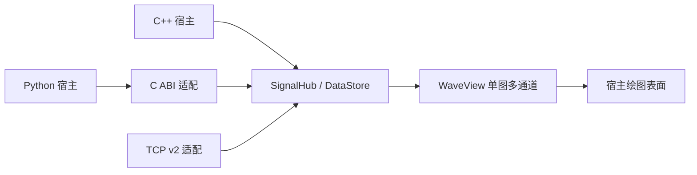

# Wave 嵌入与交互设计

当前框架面向一个宿主界面、一块多通道波形绘图区。宿主负责设备采集、界面布局和消息循环，Wave 负责缓存、按视区查询及波形交互。C++/Win32 与 Python/Tkinter 两个 Demo 用来验证这条接入链。

## 文档定位与维护

本文件是项目架构维护入口，记录采用的边界约定、当前实现、待收敛项和验证范围。数据与报文的详细契约由 [协议说明](PROTOCOL.md) 维护，构建和使用入口见 [README](../README.md)。相关变更在同一提交中同步这些描述，维护规则见 [AGENTS.md](../AGENTS.md)。

最近一次架构核对为 2026-11-13，依据包括公开接口、数据和适配层实现、CMake 目标及已有验证结果。当前采用 Session / Stream / View 三个对象的职责划分，数据层独立构建已验证。下文“当前架构的后续调整点”仍是待实现事项。后续修改本文件时，按实际核对内容更新日期与状态。

## 最小组件架构

组件对外围绕三个对象组织。数据会话拥有注册表和缓存，流句柄接收一组同步通道的批次，视图负责一块绘图区的配置、状态和绘制。流与视图分别持有数据会话，采集和显示有各自的生命周期。



图中箭头表示调用或数据读取路径。内部数据结构只承载流、通道、序号、时间和样本。协议封包位于接入端，窗口句柄和 GPU 资源位于绘图表面适配端。C++ 和 Python 最终使用同一份 C++ 缓存与绘制实现。

| 边界 | 对应实现 | 对外约定 |
| --- | --- | --- |
| 数据会话 | `SignalHub`、`DataStore`、C ABI 的 session | 注册描述符、管理容量、整批提交和按视区查询 |
| 采样流 | `SignalHub::Source`、C ABI 的 stream | 稳定 ID，一组同步通道、一个时间模式和有序写入端 |
| 单图视图 | `WaveView` | 通道可见性、显示范围、自动 Y、暂停状态和绘图 |
| 语言与传输适配 | `wave_native.h`、`python/`、`tcp_source.hpp` | 转换参数与错误，调用核心提交方法 |
| 宿主绘图适配 | ImGui 帧循环、Windows 子控件 | 父控件、尺寸、DPI、输入、上下文与 GPU 生命周期 |

### 数据入口的最小约定

一次注册提交流 ID、固定顺序的通道描述符和采样时序。高频提交只携带帧序号和交错样本，元数据由已注册的流句柄定位。通道的名称、单位和 ID 在注册时复制到组件。

| 数据 | 当前约定 |
| --- | --- |
| 通道描述符 | `id`、`name`、`unit` |
| 规则采样流 | 正采样率，时间按帧序号除以采样率计算 |
| 按实际时刻提交的流 | DLL 使用宿主提供的公共时间基准，TCP 使用接收端打点 |
| 样本批次 | 连续 float32，排列为帧 0 的全部通道、帧 1 的全部通道 |
| 提交结果 | 成功后返回 `next_frame`，参数校验失败拒绝该批次 |
| 输入内存 | 在调用期间复制，返回后宿主可复用 |
| 缓存 | 每通道默认 50,000 帧，容量满后覆盖最旧历史 |

成功提交表示缓存已经接受数据，绘图由宿主的重绘节奏读取。兼容重连根据 `next_frame` 继续写入。采集重新计数时，宿主开启新会话或使用新的逻辑流标识。C ABI v1 与 TCP v2 分别定义语言调用布局和网络报文格式。[报文与数据边界](PROTOCOL.md)

### 线程与资源归属

宿主的采集线程持有写入句柄，UI 线程持有视图和绘图表面。DLL 会话锁串行保护描述符、整批提交、容量切换与视图读数。宿主直接使用 C++ 数据层时，按相同原则串行注册和容量变更。像素查询和降采样在绘图阶段完成。

卸载视图时先停该视图的重绘，再在 UI 线程释放图形资源。结束采集时先停生产者并等待调用返回，再释放写入句柄。会话数据随最后一个持有者释放。暂停快照与原始采样缓存分别管理，恢复显示时读取最新缓存。

### 按依赖选择构建

| 目标 | 内容 | 构建入口 |
| --- | --- | --- |
| `Wave::data` | 缓存、校验和查询，C++ 标准库与线程支持 | `WAVE_BUILD_VIEW=OFF` |
| `Wave::view` | 数据层加 ImGui/ImPlot 波形绘制 | 默认启用，可使用宿主已有绘图库目标 |
| `Wave::native` | Windows 子控件与 C ABI DLL | `WAVE_BUILD_NATIVE=ON` |
| 两个宿主 Demo | 模拟采集与宿主界面验证 | C++ 构建目标、Python 启动脚本 |

在新的构建目录中关闭 `WAVE_BUILD_VIEW` 后，默认构建数据层。已有构建目录继续沿用其缓存选项，显示后端需要对应的视图依赖。数据层的独立构建用于验证核心与宿主技术栈之间的边界。

### 当前架构的后续调整点

| 当前实现 | 收敛目标 |
| --- | --- |
| C ABI 数据函数与 Windows 窗口函数集中在 `wave_native.cpp` | 按职责拆开内部实现，发布物仍可组合为一份 DLL |
| TCP 接收后的提交由 `Receiver::poll()` 在 UI 循环执行 | 接入端通过会话提交入口同步提交，ACK 来自实际提交结果 |
| 通道 ID、名称和采样率的注册校验分散在 C ABI 与 TCP 入口 | 在核心注册方法中统一流语义校验，各接入端负责自己的编码和封包检查 |

这三项仍需后续落实。当前架构以三个已有构建目标和明确的数据契约为基础演进。新增宿主框架从绘图表面适配进入，新增采集来源从描述符和批次提交进入。

## 今天可以怎样接入

同进程 C++ 宿主可链接 `Wave::data`，用 `DataStore::configure()` 注册通道，采集线程按批调用 `append()`。等间隔数据按帧交错，例如两通道两帧为 `[A0, B0, A1, B1]`。调用返回后可复用输入内存。使用 ImGui/ImPlot 的宿主再链接 `Wave::view`，在自己的窗口或子区域逐帧调用 `WaveView::draw()`。`WaveView::state()` 可读取用户操作后的范围、暂停和自动 Y 状态。[接入代码和 CMake 用法](../README.md#嵌入上位机)

Windows 上还可使用 `Wave.dll`。导出的 C ABI v1 见 [wave_native.h](../src/wave_native.h)，Python 标准库封装见 [wave_native.py](../python/wave_native.py)。组件创建属于宿主的 `WS_CHILD` 绘图窗口，每个窗口拥有独立的 ImGui/ImPlot 上下文、GPU 资源和显示状态。宿主提供父窗口句柄、位置和渲染定时器，DLL 内每次调用和窗口消息处理结束后恢复之前的 GUI 上下文。C++/Win32 与 Python/Tkinter 两个可运行 Demo 使用同一个 DLL。[ctypes 文档](https://docs.python.org/3/library/ctypes.html) · [Win32 子窗口](https://learn.microsoft.com/en-us/windows/win32/api/winuser/nf-winuser-createwindowexw)

DLL 的所有视图使用同一系统单调时钟驱动共享缓存的滚动。直接使用多个 ImGui 上下文的 C++ 宿主可调用 `view.draw(fingers, monotonic_seconds)`，给同一数据会话传入一致的单调时间。单上下文宿主可以继续使用 `draw()`。

### Windows DLL 与 Python 的最小接入

将 `python/` 加到宿主的模块搜索路径，或将其中的接口模块放入宿主项目。给 `Library(path)` 传入匹配宿主位数的 DLL 路径。

```python
from array import array
from wave_native import Library

session = Library("path/to/Wave.dll").session(capacity_frames=50_000)
stream = session.open_stream("motor", [
    {"id": "ia", "name": "Phase A", "unit": "A"},
    {"id": "ib", "name": "Phase B", "unit": "A"},
], sample_rate=50_000)
view = session.create_window(parent_hwnd)  # 宿主 UI 线程
view.set_bounds(0, 0, width_pixels, height_pixels)

# 采集线程。交错 float32，返回后可复用输入数组。
next_frame = stream.append(array("f", [0.1, 0.2, 0.3, 0.4]))

# 宿主 UI 定时器，每帧一次。
view.render()
state = view.state()

# 退出时先停止采集线程和 UI 定时器。
view.close()  # 创建该视图的 UI 线程
stream.close()
session.close()
```

- 同一会话的注册、写入、容量切换和视图读数通过一把锁串行。写入调用直接提交到缓存。每个流保持一个活动写入句柄，重复 ID 的同时注册会报错。关闭后用同一 schema 重开可接着原序号写入。
- `append()` 接受 `array('f')`、连续 float32 NumPy 数组或普通平铺序列。可写连续 float32 缓冲区直接传指针，DLL 在调用内复制到环形缓存。只读缓冲区先作一次 Python 侧拷贝。显式传入 `first_frame` 时拒绝倒退序号和非法样本，失败返回前不接受该批次。
- `sample_rate=0` 的流调用 `append_received(values, seconds)`，每次提交一帧，各来源的秒数由宿主放在同一时间基准上。均匀采样源使用 `first_frame / sample_rate` 的时间。
- 数据会话、流和视图分别持有共享数据的所有权。关闭会话句柄后，已存在的流和视图仍持有数据。修改容量时流句柄在锁内重新定位数据池，暂停快照继续独立存在。释放某个句柄前应结束对它的并发调用，Python 封装还会串行该句柄的调用和 `close()`。
- 创建、改变位置、绘图、配置和销毁原生视图都在父窗口所属 UI 线程执行。宿主负责消息循环与 DPI 策略，尺寸按像素传入。隐藏页面时可停绘，恢复时调用 `render()`。父窗口先销毁后，应继续关闭 Wave 视图句柄以释放图形资源。[Tkinter 线程模型](https://docs.python.org/3/library/tkinter.html#threading-model)
- C 函数返回状态码，错误文字通过 `wave_last_error()` 在当前线程立即读取。异常在 DLL 边界转换为状态码。Python 封装为失败调用抛出异常，并检查 ABI 版本。
- 原始双指坐标按向右、向上为正处理。宿主可用 `set_reverse_scroll()` 调整转换后滚动消息的方向，两个 Demo 提供对应复选框。Demo 默认勾选，匹配当前远程桌面的实测方向。

两个 Demo 都使用后台生成的 2 通道、20 kSa/s 模拟数据，宿主顶栏可切换暂停、自动 Y 和时间跨度。它们分别验证 Win32 与 Tkinter 的实际子控件挂载。Qt/PySide 等其他宿主的框架生命周期和重绘适配待选定后验证。

直接使用 C++ `SignalHub` 时，注册和容量调整由宿主在 UI 线程串行执行。独立 Demo 的 TCP 数据经 `Receiver::poll()` 提交。元数据固定后的 `DataStore` 可从后台写入。DLL 接口在会话内补充串行保护。宿主复用自己的设备连接，外部进程供数可继续使用 TCP 适配器。[数据交互边界](PROTOCOL.md#component-data-design)

## 单图交互

| 操作 | 响应 |
| --- | --- |
| 双指或右键拖动 | 由两个方向的位移分别控制 X、Y 缩放，右上看细节，左下看全貌 |
| 左键拖动 | 实时平移 Y，暂停后平移 X/Y |
| 双击绘图区 | 暂停或恢复显示，后台继续接收，恢复时跟上最新缓存 |
| 宿主控件 | 调用与图内交互相同的配置入口，通过 `state()` 读取实际状态 |

原始双指位移向右、向上分别为正，按逻辑像素传给 `TouchpadDelta`。原生控件以子窗口接收位置、焦点、捕获和松开事件。宿主有自己的手势识别时可继续直接使用 C++ `WaveView`。

## 当前验证边界

已用 Windows C++/Win32、Python/Tkinter 验证父窗口内挂载、后台批量写入、缩放、暂停恢复、改变尺寸和销毁。用户界面各自只有一块波形区，Demo 使用两通道模拟采样。PySide/Qt 等宿主选型后可复用相同数据入口，并验证对应框架的生命周期与重绘。
