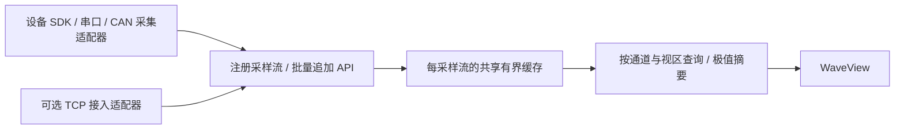

# Wave TCP v2

Wave is an independent local display component. Start it with `run.cmd`; start
your producer separately. Neither process owns the other's lifetime. Wave is
empty before registration and displays all registered channels by default.
The reusable WaveView has no transport dependency. Zoom, pan and display-only
pause are local to the view; there are no wire commands for display navigation.

## Lifecycle

1. Connect to 127.0.0.1:18765.
2. HELLO: identify the source; wait for success.
3. REGISTER: atomically declare all channel metadata; wait for handles and next index.
4. DATA / DATA_NOW / CLEAR_CHANNEL / CLEAR_SOURCE: send a request, then wait for its reply.

Wave accepts multiple independent sources concurrently. Each TCP connection owns
one source ID and one synchronous group of 1..64 float32 channels. Each group
chooses its own uniform rate (up to 1 MHz) or receiver timing. Different groups
may use different rates and modes. A second live connection claiming the same
source ID is rejected, without interrupting the existing owner. Channel identity
is the pair (source ID, channel ID); handles remain local to the connection's source.

Limits: 32 concurrent connections, 32 retained sources and 256 total channels per
Wave session. Buffer settings use an estimated 512 MiB sample-storage allocation
budget; actual process memory also includes summaries, snapshots and graphics.
Dynamic edits of a registered schema, different rates within one group, explicit
device timestamps and external window-control commands are not implemented.
Use another source ID for a new schema, or restart Wave to start fresh.

Reconnect with the same source ID and identical metadata in the same order.
Wave retains data, host visibility choices and clear boundaries and returns the next
sample index. No batch is automatically replayed after an uncertain connection
failure: reconnect/register and use the returned index. Reconnecting after Wave
restarts creates a fresh session with index zero. In uniform mode disconnect downtime is not
represented unless the producer advances its sequence explicitly; a sequence gap
retains history within timeline capacity and connects the real samples across missing slots.
Missing slots consume capacity, are never zero-filled and are not counted as received samples.

## Framing

Little-endian integers and IEEE754 numbers, no native struct padding. All requests
and responses use this 20-byte header:

| Offset | Type | Meaning |
| --- | --- | --- |
| 0 | u32 | Magic 0x32564157 |
| 4 | u32 | Version 2 |
| 8 | u32 | Message type |
| 12 | u32 | Nonzero request ID, echoed in reply |
| 16 | u32 | Payload byte length, at most 1,048,576 |

Text is u32 byte length followed by UTF-8 bytes (no terminator). Maximum 256 bytes;
control characters, invalid UTF-8 and ImGui's reserved `##` delimiter are rejected.
IDs/names must be nonempty; unit can be empty. Display names may repeat; IDs must
be unique within the source. Units remain metadata available to the host, and are not appended automatically
to the legend.

### HELLO (1)

Payload: source ID text, source display-name text. Source name is currently
validated but not used for window titles. No source process is launched by Wave.

### REGISTER (2)

Payload: u32 channel count, followed by this descriptor for each channel:

`text id, text name, text unit, u32 value_type, u32 time_mode, f64 sample_rate_hz`

Supported value_type=1 (float32). time_mode=1 is uniform sampling with a positive
sample rate; time_mode=2 is receiver timing and requires sample_rate_hz=0.
All channels must use the same mode and rate. Registration is atomic; an error leaves the existing schema/data intact.
This constraint is per source connection; other sources may use different modes/rates.
On success the reply extra data is `u64 next_frame, u32 count, count * u32 handle`.
Handles start at 1 and are stable across compatible reconnects.

### DATA (3)

Payload: `u64 first_frame, u32 frame_count, interleaved float32 values`.
Count is 1..4096, also limited by the frame payload cap. Each frame includes all
channels in registration order. One point per channel is simply count=1.
Sample spacing is determined by frame_index / registered_sample_rate, plus the
source's fixed display offset described below; packet-to-packet arrival jitter
does not change it. Values must be finite; stale/backward indices are rejected.
Reply extra data is u64 next_frame. Validation completes before buffer mutation.
This message is only valid for time_mode=1.

### DATA_NOW (6)

Only valid for time_mode=2. Payload: exactly one float32 value per registered
channel, in registration order. There is no timestamp, frame index or count.
Thus a single-channel point has a 4-byte payload; two channels have 8 bytes.
One request represents one synchronous point per channel, never a batch.

Wave captures the system monotonic clock after the complete message is received,
before waiting for the GUI thread. The first accepted data message across all
sources defines the common time origin; a later source does not start again at zero.
Subsequent points retain their actual receive intervals. The clock is unaffected
by wall-clock adjustments; it is not a calendar/UTC timestamp or a device sampling
timestamp. TCP and sender delays affect it. Identical clock readings are advanced
by the smallest representable increment to preserve strict ordering.

Reply extra: `u64 next_frame, f64 receive_time_seconds`. The next index is assigned
by Wave. Reconnecting the same source/schema keeps the common time origin and includes
disconnected elapsed time; Wave restart creates a new origin. Clear commands do
not reset it. Values must be finite; wrong sizes/modes are rejected atomically.
Use uniform DATA batches for high-frequency acquisition; DATA_NOW is convenient
for irregular single-point telemetry. Automatic batch display smoothing is not
applied to irregular receiver-timed points.

Disconnect retains metadata and history for inspection/reconnection. Registered
channel names remain in the legend; there is no signal menu. The host controls
visibility through WaveView's API, preserving choices across reconnects. Existing
plots retain their history. No TCP addresses, protocol IDs or source groups appear in the normal UI.
Repeated names receive display-only numeric suffixes; registration order and
selection identity stay stable across reconnects.

### Common display timeline

Uniform source timestamps displayed by Wave are `offset + frame_index / rate`.
Wave anchors the last sample in a source's first accepted batch to the receive
time of that batch on the common clock. Earlier samples in that batch can have
negative times. The offset is then fixed, including across compatible reconnects;
later network jitter does not stretch sample spacing. The producer must advance
its sequence to represent unrecorded time, including downtime on reconnect.

This is software alignment, not hardware clock synchronization: capture latency,
transport latency and independent device clock drift remain. Receiver-timed
points directly use the common receive clock. External programs still send no
timestamps in either mode; the existing v2 layouts are unchanged.

Each view follows only its host-selected visible signals. There is no X linking.
If any selected source is
online with data, disconnected sources do not drive the live playhead. Unselected
producers never advance the visible timeline. Selected sources still retain
their true relative time offsets; different update rates are not time-shifted
just to force every signal endpoint onto the same pixel.

Each connection has its own worker and at most one pending request. The UI polls
all connections fairly, commits data, then returns ACK. One partial/idle peer
cannot block the others. All source stores are UI-committed. Source clear commands
affect only their own source. Double-click pause holds the displayed data while reception continues.
Local/global clear and buffer-resize UI controls remain removed. Underlying data APIs remain available to the host.
Default capacity is 50,000 frames per channel. Synchronous channels share the frame index.

### CLEAR_CHANNEL (4) / CLEAR_SOURCE (5)

CLEAR_CHANNEL payload: u32 handle. CLEAR_SOURCE payload: empty.

These logically remove history before the next sample index for one channel or
all channels of this source, respectively. Every view stops showing those old
samples on its next display refresh. They do not change host visibility, reset indices or affect another
channel when clearing one. New samples continue normally. Underlying ring memory
is reused, not securely erased. Independently held immutable snapshots remain
immutable; paused views apply the live clear cutoff when querying their frozen data.

### REPLY (128)

`u32 status, text error_message, optional extra data`

status=0 means committed successfully; status=1 means rejection. An error carries
a human-readable reason and has no extra data. The request ID must match. Semantic
errors allow correction on the same connection. Invalid framing/version/oversize
headers close the connection because framing cannot be trusted. An incomplete
header/payload or handshake times out after 5 seconds; a registered idle connection
stays open. The sender must wait for each reply; bounded request/response flow is
the initial backpressure policy. At high sample rates use batches: one packet per
point is not intended as a high-throughput mode.

## Python example

`examples/wave_client.py` uses only the Python standard library:

```python
from wave_client import WaveClient

with WaveClient("motor-1", "Motor test") as wave:
    current, speed = wave.register_channels([
        {"id": "ia", "name": "A 相电流", "unit": "A", "sample_rate": 1000},
        {"id": "speed", "name": "转速", "unit": "rpm", "sample_rate": 1000},
    ])
    wave.append([1.2, 300])
    wave.append_batch([[1.3, 301], [1.4, 302]])
    wave.clear_channel(current)  # shared current history only
    wave.clear_source()          # all history for this source
```

The client reports transport and server errors; it does not spawn Wave or silently
retry uncertain commands. The real system-source executable separately implements
reconnection and always re-registers before sending.

Wire v2 replaces the fixed CPU/memory v1 prototype; old producers must be rebuilt.

Receiver-timed single points (can coexist with other source IDs):

```python
import time
from wave_client import WaveClient

with WaveClient("telemetry", "Telemetry") as wave:
    wave.register_channels([
        {"id": "temperature", "name": "温度", "unit": "°C"},
    ], time_mode="receiver")
    print(wave.append_now([25.1]))  # seconds on Wave's common timeline
    time.sleep(0.37)
    print(wave.append_now([25.2]))  # about 0.37 s later; no timestamp sent
```

<a id="component-data-design"></a>

## 组件数据交互设计草案（2026-11-12）

本节是结合本项目源码及成熟方案提出的下一阶段设计，尚未实现新的 WaveData API、时间戳模式或 TCP v3。当前显示层保留单一实时滚动、轴区域缩放、平移和双击暂停；按最新要求已撤回相对时间轴和定时最新帧快照，也不包含边沿触发。现有 v2 报文兼容。

### 暂定规模与预算

根据本次讨论，按“每个采样流保留 50,000 帧、所有流合计最多 20 通道、每通道最高 50 kSa/s”设计。一帧指同一采样时刻各通道的一组值，不是屏幕刷新的一帧。

| 项目 | 设计目标与含义 |
| --- | --- |
| 通道数 | 所有保留的采样流合计最多 20；关闭后仍保留历史的流也计入预算，移除流后释放 |
| 缓存 | 每流 50,000 个采样帧位置；同流全部通道共用帧序号和时间轴，多个视图不复制原始缓存 |
| 最高采样率 | 每通道 50,000 samples/s；所有通道满速为每秒 1,000,000 个数值 |
| 历史时长 | 50 kSa/s 时 1 秒；1 kSa/s 时 50 秒；不规则采样按点数限额，时间长度随实际到达变化 |
| float32 原始数值 | 峰值约 4,000,000 B/s；满缓存约 4,000,000 B，均约 3.81 MiB |
| float64 原始数值 | 对应约 8,000,000 B/s 和 8,000,000 B；属于拟新增能力，当前只存 float32 |
| 不规则时间戳 | 一个流每帧一个 int64 时间戳；最坏 20 个独立单通道流另需约 8 MB 缓存和 8 MB/s 时间戳吞吐 |
| 数据内存预算 | 建议初值 64 MiB、按需使用，纳入数值、时间戳、极值摘要、缺口及适配器暂存；图形后端内存另计 |
| 推荐批量 | 满速默认约 1,000 帧/批，即 20 ms；20 通道 float32 一批约 80 kB、每秒 50 批，可调整延迟与吞吐 |
| 可选采集暂存 | 约 100 ms / 5,000 帧，并设全局字节限额；它与 50,000 帧的显示历史分别计量 |

当前 Demo 与默认数据池均采用每通道 50,000 帧，宿主可通过数据 API 调整容量。20 通道满速运行仍是设计验收目标。v2 继续按 32 个来源、256 个总通道和最高 1 MHz 的元数据范围校验。

### 参考成熟方案后的取舍

| 官方资料/源码 | 已核实的做法 | 对 Wave 的建议 |
| --- | --- | --- |
| [PlotJuggler DataStreamer](https://github.com/PlotJuggler/PlotJuggler/blob/main/plotjuggler_base/include/PlotJuggler/datastreamer_base.h)、[PlotDataMapRef](https://github.com/PlotJuggler/PlotJuggler/blob/main/plotjuggler_base/include/PlotJuggler/plotdata.h) | 流接入、解析工厂与时序数据容器有独立接口，共享数据更新有明确的互斥约束 | 设备解码放在适配器，核心只接收标准化采样；定义线程和数据所有权 |
| [LSL 概念](https://labstreaminglayer.readthedocs.io/info/intro.html)、[Stream Info](https://labstreaminglayer.readthedocs.io/projects/liblsl/ref/streaminfo.html) | 区分流元数据、同步多通道采样和批次；流描述包含频率、格式及来源身份 | 使用 Source / Stream / Channel / Batch，按采样同步关系分组 |
| [LSL 时间同步](https://labstreaminglayer.readthedocs.io/info/time_synchronization.html)、[内部结构](https://labstreaminglayer.readthedocs.io/projects/liblsl/internals/overview.html) | 区分单调时钟、时钟偏差和显示/处理；数据接收与应用读取有独立边界 | 明确采样时间和接收时间的质量差别，采集提交不依赖绘图刷新 |
| [SciChart DataSeries](https://www.scichart.com/documentation/win/current/Manipulating%20DataSeries%20Data.html) | 类型化数据序列支持批量追加和有容量上限的 FIFO | 保留批量追加、固定容量和共享读取，优先测量这些简单路径 |
| [PyQtGraph PlotDataItem](https://pyqtgraph.readthedocs.io/en/latest/api_reference/graphicsItems/plotdataitem.html) | 支持视区裁剪、降采样，以及对无效点/线段连接方式的选择 | 显示查询与原始数据分开；缺失数据的连线策略应显式配置 |

下面的接口、预算和迁移顺序是针对 Wave 的设计判断，不是这些项目共同规定的标准。本轮没有引入上述库作为新的运行依赖。

### 当前 TCP v2 承接什么

| 消息/机制 | 当前实际功能 |
| --- | --- |
| HELLO | 声明来源 ID、名称，限制同一个来源被两个在线连接同时占用 |
| REGISTER | 一次声明 1–64 个同步通道的 ID、名称、单位、float32 类型、时间模式和频率；返回句柄及下一帧序号 |
| DATA | 等间隔单帧或批量数据：首帧序号、帧数、帧优先交错数值；同一帧包含全部注册通道 |
| DATA_NOW | 不规则的一组同步通道值；接收端赋时间，当前每条消息只有一帧 |
| CLEAR_CHANNEL / CLEAR_SOURCE | 清除一个通道或一个来源此前的可见历史，保留序号及后续接收 |
| REPLY、重连 | 返回成功/错误和提交后的序号；兼容元数据的来源可重连延续 |
| 校验与边界 | 固定帧头、长度、版本、序号、元数据、有限数值校验，以及有界请求/响应流程 |

它承担本机外部进程到 Wave 的采样接入。设备串口、USB、CAN 解码、设备控制、录盘、窗口布局、缩放指令都没有由这份协议承接。同一上位机进程内可直接调用数据 API。

当前数据路径是：
`外部程序 → v2 解帧/校验 → UI 线程 Receiver::poll → SignalHub → DataStore → 按时间/像素查询 → WaveView`。
DataStore 本身支持配置稳定后的后台 append；“必须等 GUI”的问题来自当前 TCP 提交流程，而非 TCP 或所有数据 API 的必然要求。

### 现有设计是否合理

适合作为当前本机采样接入的基础：二进制批次、元数据先注册、缓存有界、序号检查和错误回执都可以保留。建议优先调整以下边界：

1. **来源与同步组混在一起。** 当前一个 source 对应一个连接和一个 DataStore。同一设备有不同采样率时要开多个 source/连接。应在组件内明确设备来源与采样流两个身份。
2. **ACK 受绘图节奏影响。** 当前每连接只有一个在途请求，且由 poll 每轮处理一次；粗略吞吐上界是“poll 次数/秒 × 每批帧数”，还有 CPU/网络开销。50 kSa/s、1,000 帧/批已经需要约 50 次提交/秒；声明支持 1 MHz 不等于能持续接收该速率。应将提交和 ACK 移出 GUI 生命周期。
3. **时间质量不足以用于精确对齐。** 等间隔模式用序号/频率推导时间、首批接收时刻估计偏移；DATA_NOW 使用消息收齐时刻。两者都不能证明不同设备的采样同步。
4. **通道选择接口目前依赖数组索引。** 索引和显示名称适合临时展示；保存布局、重连恢复、多个来源同名时，应使用稳定的 ChannelKey。
5. **缺口显示需要明确语义。** 当前缺帧不补零，但连接相邻真实点。测量场景应能选择断线或连接，并保留缺帧数量和有效性信息；本轮尚未改变已有连线行为。
6. **重启与重连需要区分。** 当前兼容重连沿用 next_frame，清空也不重置序号。采集设备重启归零应开启新 epoch，不能作为旧会话的连续数据接入。

### 推荐的组件模型



- **Source**：物理设备或逻辑采集来源，source_id 稳定，例如 motor-01；连接地址和窗口名称都不能作为唯一身份。
- **Stream**：真正同步采样的一组通道，有独立频率、格式、时间基准和序号。例如同一次 ADC 采样的 ia/ib/ic 属于同流。仅频率相同不代表同步。
- **Channel**：流中的一个量，有固定 ID、名称、单位。不同频率/采样时刻的量分流，不为凑帧重复填充未更新的值。
- **Batch**：一个流内连续若干帧。每帧按固定通道顺序排列；高频路径不逐点重复 ID、名称和单位。

例如 `motor-01/foc` 包含三相电流、50 kSa/s；另一个 `motor-01/temperature` 可按实际采样时序独立提交。所有流的通道总和受 20 通道预算约束。

持久化身份采用 `ChannelKey = (source_id, stream_id, channel_id)`。运行时可换成小整数句柄加 generation，避免逐批字符串查找；句柄不作为跨会话配置保存。描述符在一个 epoch 内不可变，通道顺序、数值格式、采样率改变或采集重启时产生新 epoch。旧写入句柄必须返回 StaleHandle/Closed，不能写进新流。

### 数据结构与 API 草案

以下为拟议接口，尚未加入正式头文件；当前可调用 API 仍是 DataStore / SignalHub。

```cpp
enum class TimeMode { Uniform, Explicit };
enum class SampleFormat { Float32, Float64 };
enum class TimeQuality { Received, HostCapture, DeviceMapped };

struct ChannelDescriptor {
    std::string id, name, unit;
};

struct StreamDescriptor {
    std::string source_id, stream_id, epoch_id;
    std::uint32_t schema_version = 1;
    std::vector<ChannelDescriptor> channels;
    SampleFormat format = SampleFormat::Float32;
    TimeMode time_mode = TimeMode::Uniform;
    std::uint32_t rate_num = 50'000, rate_den = 1;
    std::int64_t origin_time_ns = 0; // 此 epoch 第 0 帧的会话时间
    std::string input_clock_id;
    TimeQuality time_quality = TimeQuality::Received;
};

enum class AppendStatus { Committed, InvalidBatch, StaleHandle, Closed, BudgetExceeded };
struct AppendResult {
    AppendStatus status;
    std::uint64_t next_frame;
    std::uint32_t committed_frames; // 失败为 0，成功为整批帧数
};

struct BatchView {
    std::uint64_t first_frame;
    std::uint32_t frame_count;
    std::variant<std::span<const float>, std::span<const double>> values;
    std::span<const std::int64_t> time_ns; // Explicit: 每帧一个
    std::span<const std::uint8_t> valid_bits; // 可空；否则每数值一位
};

// 管理接口注册一次；生产者持有绑定 stream/epoch 的 writer。
// auto writer = data.register_stream(descriptor, {.capacity_frames = 50'000});
// auto result = writer.append_copy(batch); // 返回时本批已提交或整批拒绝
// auto points = data.query(channel_key, tmin, tmax, pixel_width);
```

Uniform 模式的 time_ns 必须为空；Explicit 模式的长度必须等于 frame_count。valid_bits 为空表示所有值有效，否则字节数必须等于 ceil(frame_count × channel_count / 8)，位顺序与 values 顺序一致，尾部未使用位为 0。

二通道、两帧批次的排列为 `[A0, B0, A1, B1]`，数值数量必须等于 `frame_count × channel_count`。格式由流描述符确定，不能在同一流里逐帧变化；其他整数/编码类型在适配器转换或另行保留原始记录。float64 也不能表示任意 int64 的所有整数，超大绝对计数需要适配器保留原值，并向绘图层提供相对量等合适表示。

默认 append_copy 在调用期间复制数据，返回后调用者可以立即复用输入内存；缓存容量满时覆盖最旧历史，不丢弃新提交的整批。参数、形状、有效值、时间和序号校验失败时整批不提交，并返回明确错误及当前 next_frame。被有效性位标成无效的值不用于连线或极值，不能用数值 0 代替“没有测到”。

初版先保留明确的复制和短临界区语义；按 4 MB/s 原始数值目标压测后，再决定是否增加转移所有权的块接口。异步接口若将来引入，必须单独说明“已入队”和“已提交”，不能让一个 Accepted 回执含糊表示两者。

### 时间模型

宿主提供同一 SessionClock 和会话 ID，同进程采集适配器可调用 now_ns() 取实际采集时刻。核心统一使用相对同一会话起点的 int64 纳秒时间；渲染时转为相对秒 double。设备原始时钟到会话时间的转换由采集/时钟映射适配器负责，并标注质量，未知同步误差不得假设为零。

- Uniform：`t(i) = origin_time_ns + i × 1e9 × rate_den / rate_num`；50 kSa/s 为 20 微秒间隔。网络到达抖动不修改采样间隔，计算需检查溢出与舍入。
- Explicit：rate_num 为 0、rate_den 为 1，每帧有一个会话时间；帧序号递增、时间不能回退。拟允许相同时间戳以表示分辨率有限的同时事件，用序号区分，避免伪造设备时间；现有 v2 的 receiver 时间仍使用其原有严格递增规则。
- Received 只表示接收时间，适合状态趋势；HostCapture 表示主机实际采集时刻；DeviceMapped 表示设备时间经过明确映射。该分类本身不保证硬件同步。
- DisplayClock 只改变显示播放头，不重写采样时间；硬件同步、校时漂移、固定采集延迟必须另行标定。

### 线程、读取和积压

推荐首版由采集工作线程直接批量调用线程安全的核心写入接口，WaveView 按 GUI 刷新率拉取视区数据。核心不绑定 ImGui，也不要求自带线程池。

每流采用串行写入者和短临界区；多个来源并行工作。目录管理提供稳定的描述符快照和共享生命周期，绘图查询复制出少量视区点后释放锁，再进入 ImPlot/GPU，绘制过程不持有缓存锁。当前 SignalHub 目录由 UI 线程独占，因此迁移 TCP 提交前，必须先完成目录快照/生命周期改造，不能直接把现有 poll 移到后台。

采集线程如需保证不被存储短时阻塞，可在适配器增加有界暂存。实时预览可配置丢弃最旧整批并记录缺帧；需要完整数据的记录器应使用明确的背压/失败策略，并独立记录。显示历史正常覆盖、采集丢帧、适配器溢出应分别计数。

至少提供 received_frames、committed_frames、missing_frames、queue_dropped_frames、rejected_batches、history_overwritten_frames 和 last_committed_frame 等状态。缩放、窗口大小、隐藏某条曲线均不得阻塞或停止接收。

### TCP 的迁移顺序与验收

1. 保持 v2 报文、客户端和“ACK 表示已提交 RAM 缓存”语义，先整理核心的流身份、写入/查询和生命周期。
2. 将 TCP 的解析后提交移到非 GUI 工作路径，解除每绘图帧一次 ACK 的瓶颈；同进程 SDK 直接走同一核心 API。控制和元数据可低频处理，数值批次保持紧凑。
3. v2 兼容适配时，可将已有 source_id 视作单一 stream 的兼容键；一个逻辑设备需要多流时暂用不同 source_id。只有确实需要单连接多流、显式时间戳、epoch/有效性字段时再设计 v3，给出协商和兼容测试。
4. 按 20 通道 × 50 kSa/s、50,000 帧缓存验收持续接收、环形覆盖、尖峰保留、缩放与输入响应；覆盖单流20通道和多个异步流，测量 CPU、峰值内存和提交延迟。设备时间精度另行验证。
5. 加入 GUI 暂停处理/最小化/调整窗口、来源断开/重启、非法/过期句柄、缺帧、队列溢出测试，确认吞吐与提交游标不依赖 UI 帧率。具体刷新率和延迟阈值在目标机器压测后定稿。

当前 v2 的字段和上限可继续用于兼容验证；上述设计预算、浮点类型扩展、Clock/epoch 和后台提交需要下一阶段实现及验证。
